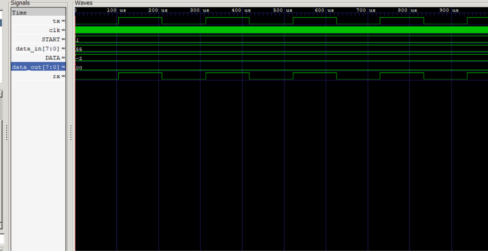

# -UART-Communication-System-SystemVerilog
UART transmitter and receiver using SystemVerilog
# UART Communication System Using SystemVerilog

## 📌 Project Overview

This project implements a UART (Universal Asynchronous Receiver-Transmitter) communication system using SystemVerilog. It includes a transmitter, receiver, and a loopback testbench to verify serial data transmission and reception.

## 🎯 Objectives

* Design a UART transmitter and receiver.
* Implement configurable baud timing using the `CLKS_PER_BIT` parameter.
* Transfer serial data from the transmitter to the receiver.
* Verify communication through simulation.

## 🛠️ Tools Used

* SystemVerilog
* Icarus Verilog
* GTKWave
* Visual Studio Code

## ⚙️ Design Features

* UART Transmitter (TX)
* UART Receiver (RX)
* Finite State Machine (FSM)-based control
* Start, data, and stop bit handling
* Parameterized baud timing
* Loopback simulation and verification

## 🧪 Verification Results

The UART transmitter and receiver were connected in a loopback configuration.
## 📈 Simulation Waveform

The waveform below shows the UART loopback simulation in GTKWave.

**Verified Test Case:**

* Transmitted Data: `01000001`
* Received Data: `01000001`
* RX Done Seen: `1`
* Result: **UART LOOPBACK TEST PASSED**

## 📂 Project Files

* `uart_tx.sv` — UART transmitter RTL
* `uart_rx.sv` — UART receiver RTL
* `uart_loopback_tb.sv` — Loopback simulation testbench

## 📚 Learning Outcomes

* RTL design using SystemVerilog
* FSM-based digital design
* Counter-based timing control
* Simulation and debugging using Icarus Verilog
* Waveform analysis using GTKWave

## 🚀 Future Improvements

* Verify additional data patterns.
* Test different baud timing configurations.
* Expand testbench coverage.
* Explore synthesis and FPGA implementation.

## 👩‍💻 Author

**Devarapalli Yashpavathi**
B.Tech ECE Student | Aspiring VLSI Design Engineer
Interested in Digital Design, SystemVerilog, RTL Design, and VLSI Research & Development.

